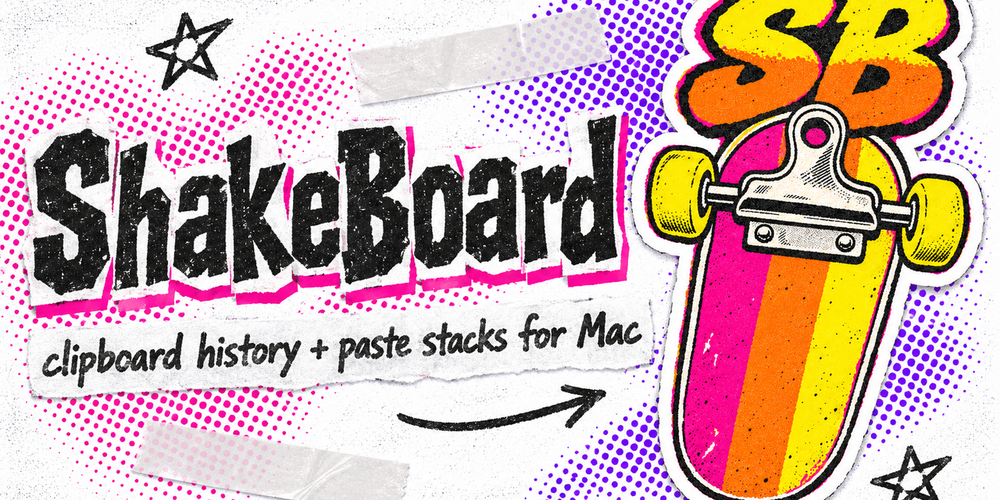
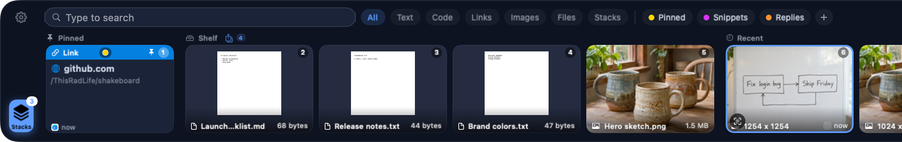
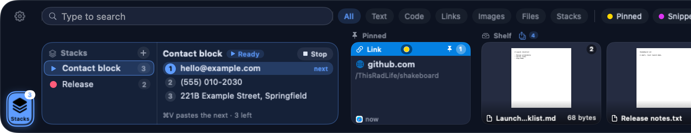
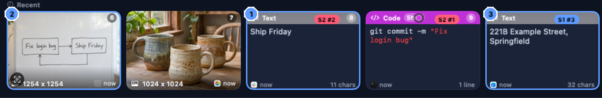
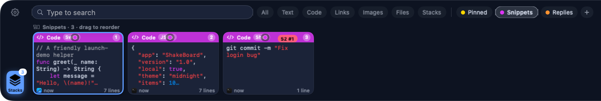
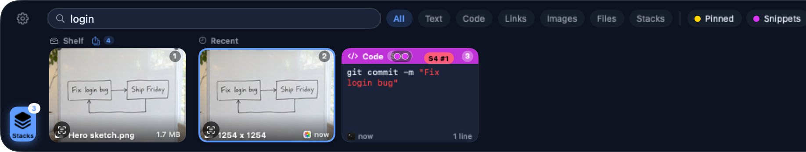
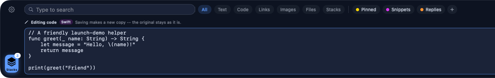
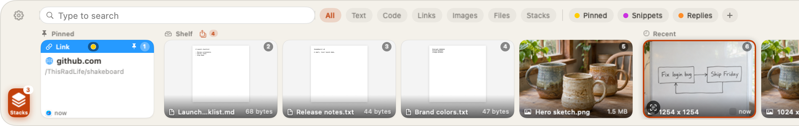
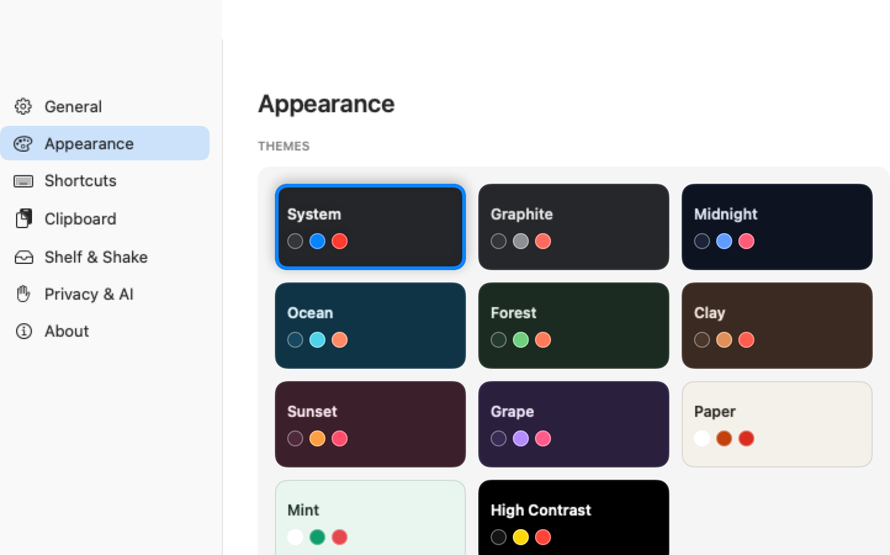
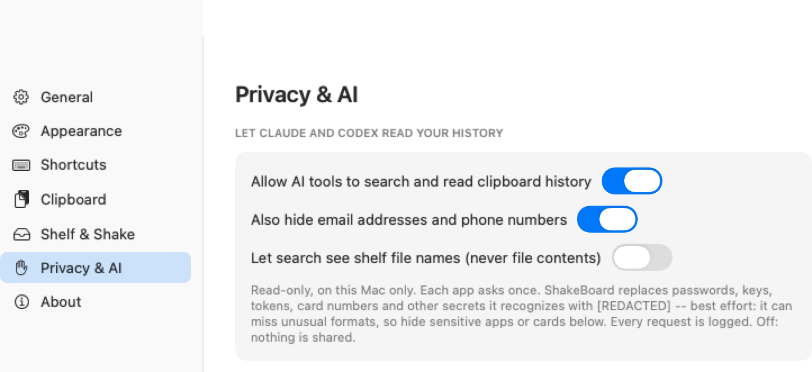

<p align="center">
  
</p>

# ShakeBoard

<p align="center"><strong>Your clipboard, files, and paste stacks. One strip at the bottom of your Mac.</strong></p>

<p align="center">
  <code>macOS 14+ badge</code>
  <code>Apache-2.0 badge</code>
  <code>latest release badge</code>
  <code>build badge</code>
</p>

<p align="center">
  
</p>

> **Formerly Perch.** Existing Perch installs migrate their data and preferences automatically the first time ShakeBoard launches.

ShakeBoard keeps the things you copy and the files you are moving in one full-width strip at the bottom of your Mac. Search clipboard history, park files, build ordered paste stacks, and pin the things you use every day. Everything stays on your Mac.

## Clipboard history

Text, highlighted code, links, images, and copied files become clear cards in one full-width strip. Search your history, press Return to paste, or use Shift-Return for plain text. Reveal ShakeBoard by shaking the mouse or pressing Command-Space.



## Drag shelf

Drag files into ShakeBoard while you work, then drag them out to Finder, Terminal, an editor, or another app. ShakeBoard preserves the original. It never relocates it.

## Paste stacks

Collect a batch of copies into a stack. Mark it Ready, then use Command-V to paste each item in order. One stack can collect while another is ready to paste. Completed stacks are archived and can be run again.

Select several cards in click order and send them to a stack together. You can also split lines, tabs, or comma-separated text into a new stack. The original card stays unchanged.





## Pinboards

Make named, colored boards for addresses, replies, code, or anything else you use often. Pinned is always the first board. A copy can belong to more than one board, and you control its order.



## On-device OCR

ShakeBoard uses Apple Vision on your Mac to recognize text in copied and shelved images. Search the result, copy it, paste it, or split it into a stack. The image does not need to leave your computer.



## Quick Look, editing, and transforms

Press Space for Quick Look. Edit text and code without changing the original card. Turn rich text into plain text, trim whitespace, change case, format or minify JSON, and remove common tracking parameters from links.



## Themes

Use System glass, choose one of ten built-in solid themes, or make your own. Custom themes control the background, cards, text, accent, and collecting colors.

<p>
  
</p>



## Install

Download `ShakeBoard-<version>.dmg` from [GitHub Releases](https://github.com/ThisRadLife/shakeboard/releases/latest), open it, and drag `ShakeBoard.app` to Applications. ShakeBoard requires macOS 14 or later. On first run, macOS asks for Accessibility permission so ShakeBoard can detect a mouse shake and advance paste stacks after Command-V.

**Coming - Homebrew cask**

```sh
brew install --cask shakeboard
```

**Built-in updates:** ShakeBoard can check for signed updates. On first run it asks, "Check for ShakeBoard updates automatically?" You can change "Automatically check for updates" or use "Check for Updates..." in Settings > General.

## Permissions

Accessibility permission powers two specific features: global mouse-shake detection and ordered paste-stack advancement after Command-V. Clipboard history does not require it. Without permission, you can still open ShakeBoard with its shortcut and use history, search, pinboards, OCR, the shelf, and other features that do not depend on those global events.

## Privacy

ShakeBoard has no accounts, analytics, telemetry, or crash-reporting SDKs. Its only network access is the optional
Sparkle update check: an HTTPS appcast request and, when you accept an update, an EdDSA-verified download from GitHub
Releases. System profiling is disabled. Clipboard history, shelf records, settings, OCR text, and MCP request records
stay in `~/Library/Application Support/ShakeBoard` on your Mac. Password managers and secure clipboard markers are
excluded from capture. See the [privacy policy](docs/PRIVACY.md) for the exact request data, local storage,
clipboard capture, MCP, and deletion details.

You can pause history, clear it, ignore selected apps, exclude apps from AI access, and mark individual cards Hide from AI. Shelf files remain in their original location. ShakeBoard stores a bookmark or an owned copy only when needed to keep access.



Encrypted backup and sync through a folder, network share, or iCloud Drive are **Coming**.

## AI access with MCP

ShakeBoard includes a local MCP bridge for Claude Code and Codex. It is off by default. Turn it on in Settings > Privacy & AI, then use the Connect control for your client. The first request from each verified client opens a consent panel. You can deny or revoke that client at any time.

ShakeBoard ships the helper at `ShakeBoard.app/Contents/MacOS/shakeboard-mcp`. Register it with the same commands shown in the app:

```sh
claude mcp add --scope user --transport stdio shakeboard -- '/Applications/ShakeBoard.app/Contents/MacOS/shakeboard-mcp'
codex mcp add shakeboard -- '/Applications/ShakeBoard.app/Contents/MacOS/shakeboard-mcp'
```

The bridge has five read-only tools:

- **`shakeboard_recent` - Recent copies** returns bounded previews, newest first.
- **`shakeboard_search` - Search copies** searches redacted text and, only when enabled, shelf file names.
- **`shakeboard_get` - Read one copy** returns one item by ID, capped at 32 KB.
- **`shakeboard_context` - Copies to summarize** returns a bounded batch with a total character limit.
- **`shakeboard_stats` - History stats** returns counts and dates without clipboard content.

Requests are limited to 30 per minute for each allowed client. Hidden apps and hidden cards are removed before tool results are built. Image pixels and file contents are never returned. Recognized OCR text may be returned after redaction. Every request is audited with its time, verified client, tool, outcome, and counts. The audit does not store clipboard text or search terms.

Redaction is best effort. It replaces recognized secret patterns before results are returned, but unfamiliar secrets can be missed. Keep AI access off when you do not need it. Use Hide from AI and app exclusions for sensitive work.


## Coming

- **Coming - Homebrew cask**
- **Coming - encrypted backup and sync** through a folder, network share, or iCloud Drive

## FAQ

### What does ShakeBoard capture?

Copied text, highlighted code, links, images, and files. It also has a separate shelf for files you drag in. Password managers and secure clipboard markers are excluded.

### Where is my data stored?

On your Mac in `~/Library/Application Support/ShakeBoard`. There is no ShakeBoard account, cloud service, or telemetry. Encrypted backup and sync are Coming.

### Why does ShakeBoard need Accessibility permission?

It lets ShakeBoard watch global mouse movement for the shake gesture and follow Command-V so a ready paste stack can advance. Clipboard history itself does not need that permission.

### Does ShakeBoard replace Command-V?

No. Normal paste works normally. A stack advances only after you mark it Ready to paste.

### What if Command-Space already opens Spotlight?

Move Spotlight to another shortcut in System Settings, or change ShakeBoard's shortcut in Settings. ShakeBoard reports a shortcut conflict instead of silently swallowing the key.

### Can ShakeBoard read text in images?

Yes. Apple Vision OCR runs on the Mac. You can search the result or turn it into a normal copy. OCR can be turned off.

### Can Claude Code or Codex read my clipboard?

Only after you enable AI access and approve that client. The tools are local and read-only. Redaction is best effort, not a guarantee.

### How do updates work?

ShakeBoard can check for signed updates. On first run it asks, "Check for ShakeBoard updates automatically?" You can change "Automatically check for updates" or use "Check for Updates..." in Settings > General. The appcast is fetched over HTTPS, downloads are EdDSA-signed, and system profiling is off. A Homebrew cask is Coming.

## Build from source

You need macOS 14 or later, Xcode 26 or later, and Tuist 4.x.

```sh
brew install tuist
tuist generate
xcodebuild -workspace ShakeBoard.xcworkspace -scheme ShakeBoard -configuration Release \
  -derivedDataPath /tmp/shakeboard-build \
  CODE_SIGNING_ALLOWED=NO CODE_SIGN_IDENTITY="" DEVELOPMENT_TEAM="" build
```

Distribution signing is configured for release builds, so local builds need the signing overrides above. The app sources are under `Sources/ShakeBoard/`. The generated app is `ShakeBoard.app`, its bundle ID is `com.thisradlife.shakeboard`, and the Share Extension hands content to the app through the `shakeboard://` URL scheme.

Run the tests with:

```sh
xcodebuild test -workspace ShakeBoard.xcworkspace -scheme ShakeBoardTests \
  -destination 'platform=macOS' \
  CODE_SIGNING_ALLOWED=NO CODE_SIGN_IDENTITY="" DEVELOPMENT_TEAM=""
```

Do not put DerivedData in this repository or in iCloud Drive.

For isolated development data, set `SHAKEBOARD_DATA_DIR`; the legacy `PERCH_DATA_DIR` name remains supported for compatibility.

## Contributing

Read [CONTRIBUTING.md](CONTRIBUTING.md) for setup, build, test, and pull-request guidance. Keep changes focused. Say which macOS version you tested and describe any manual UI checks. Use the [safe screenshot guide](docs/launch/SCREENSHOT_GUIDE.md) for launch images, and report security problems through [GitHub private vulnerability reporting](https://github.com/ThisRadLife/shakeboard/security/advisories/new), not a public issue.

## License

ShakeBoard is open-source software under the [Apache License 2.0](LICENSE). Copyright Clay Money Inc.
