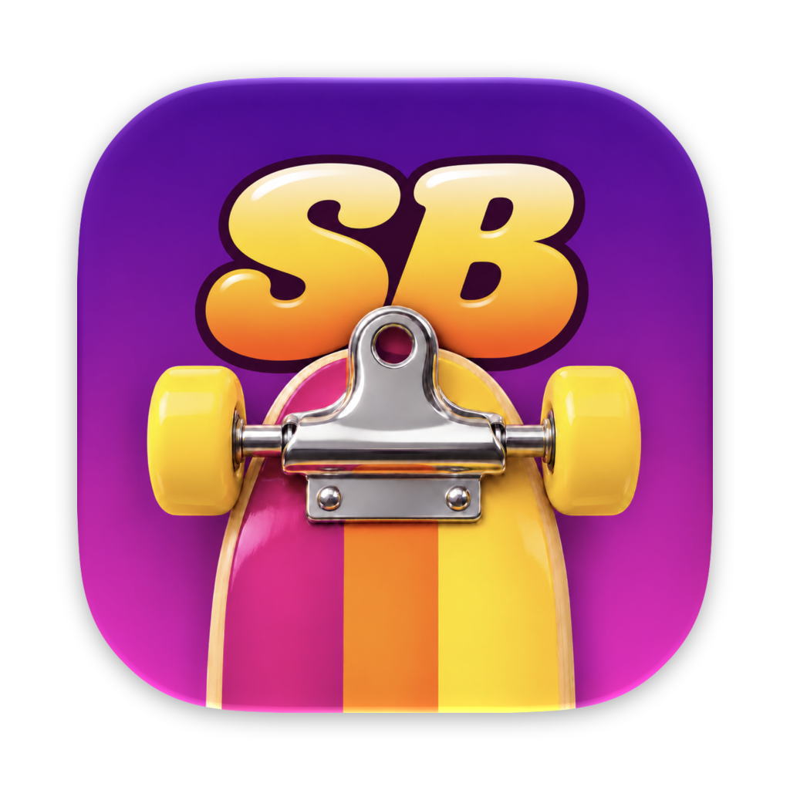

<p align="center">
  
</p>

# ShakeBoard

[](LICENSE)

ShakeBoard is a local macOS drag-shelf that parks files mid-drag so you can drag them back out later.

ShakeBoard was formerly called Perch.

Full design spec: [`docs/PERCH_PRD.md`](docs/PERCH_PRD.md).

<!-- Demo GIF not recorded yet. Record shake -> shelf -> drag out, save as docs/demo.gif,
     then uncomment the line below. Left commented so the README does not render a broken image.

-->


## Features

- Drag files in from Finder or any app, then drag them back out to Finder, a terminal, Claude, or anywhere else.
- Accept file promises as well as file URLs, so sandboxed editors such as VS Code and Mail work.
- Shake the mouse while dragging to reveal the shelf. Choose Tight, Medium, or Loose sensitivity.
- If a shake opened the strip, shake again to close it. Shaking while you're dragging something keeps it open, and a
  strip opened with Command-Space or by a copied image ignores the closing shake.
- Scrolling with a classic mouse wheel glides smoothly instead of jumping in steps, and the vertical wheel scrolls the
  strip sideways. Trackpads and Magic Mouse scroll natively. With Reduce motion turned on, scrolling doesn't animate.
- Command-Space shows and hides the strip: shelf files plus everything you copy (text, code, links, images, files),
  with search, pinboards, Return to paste, Shift-Return to paste plain, Command-E to edit and Command-T to transform.
  (Move Spotlight to another shortcut first.)
- Keep useful copies in named, colored **pinboards** such as gallery addresses or Shopify snippets. The old Pinned
  row is the default board, so existing pins stay where they were. Click a board to see its copies in your chosen
  order; drag to reorder or drag a card onto a board chip, use **Add to Pinboard** on one or several picked cards,
  or press Option-1 through Option-9. A copy can belong to several boards and stays out of history expiry while any
  board contains it. Renaming, recoloring, moving, or deleting a board never changes the copied content.
- Choose System glass or one of ten solid color themes in Settings > Appearance, or duplicate a theme and edit its
  background, cards, text, accent, and collecting colors. Changes apply to every open ShakeBoard panel immediately.
- Recognize text in copied and shelved images entirely on this Mac, then search it or right-click to copy, paste, or split it into a stack.
- Paste batches in order with **stacks**: click Stacks in the strip to see your stacks. Click a stack's circle to
  **collect** into it: every Command-C in any app lands there, and Command-V keeps pasting normally. Click **Ready to
  paste** and each Command-V pastes the stack's next item, in order. One stack can collect while another is
  pasting. When the last item is pasted the stack moves to the **Stacks** filter, where **Paste again** brings it
  back. Rename, reorder, drag cards onto a stack or use a card's **Add to Stack** menu. Deletes can be undone.
  Stacks are kept across restarts, and every launch starts with none of them collecting or pasting. While the
  strip is hidden, a slim bar under the menu bar shows what's collecting or pasting.
- **Split into Stack**: right-click a text card to break it into a new stack of pieces. Several lines split by line,
  one spreadsheet row splits by cell, a short comma or semicolon list (quoted fields respected) splits by item, and
  prose stays whole. The menu shows what it found, for example "Split into Stack (12 lines)", and **Split into Stack
  As** forces By Line, By Tab or By Comma. Each piece is saved as its own copy; the original is unchanged.
- **Pick several, send in order**: Command-click copies in the strip to pick them; each shows a number for the order
  you clicked (Shift-click adds the run between, left to right). Right-click a picked card > **Send N to Stack** >
  New Stack or an existing stack: they go in, in that order. Undo is in the stack lane (until that stack starts
  pasting). Escape, a plain click, a click on empty space, or a new search or filter clears the picks. Space previews the picks as a list; Return still pastes the one card you
  clicked last. Shelf files can't be picked (a stack holds copies, not shelf files).
- Settings live in a window opened from the gear in the strip, Command-comma in the strip, or by opening ShakeBoard
  again from Spotlight or Finder: launch at login,
  shortcuts (including an optional stack shortcut you record), history size and age, apps to never save copies
  from, pausing history, shake sensitivity and calibration, Clear History / Clear Shelf. An orange dot on the
  gear means something needs attention (Accessibility off, a save failure, a shortcut another app owns).
- No menu-bar icon. Reach ShakeBoard with Command-Space; open ShakeBoard again from Spotlight / Finder for Settings (opening
  it yourself also shows Settings once at launch; launching at login stays quiet); Command-Q in the strip or Quit in
  Settings quits. If Command-Space can't be registered, Settings opens on Shortcuts to tell you.
- Let Claude Code and Codex search and summarize your copies (off until you turn it on in Settings > Privacy & AI).
  Read-only, local only, each app asks once, secrets are replaced with `[REDACTED: kind]`, and every request is
  logged. See [AI access (MCP)](#ai-access-mcp).
- Send files, images, links, and text to ShakeBoard through its Share Extension.
- Keep items across relaunch with file bookmarks. Moved originals grey out rather than silently vanishing.
- Preserve originals. ShakeBoard copies or bookmarks files and never relocates them.
- Optionally re-encode images as JPEG with a 1568px long edge when dragging out.
- Preview chips with QuickLook and an ImageIO fallback.
- Press Space to Quick Look, like Finder: the selected or hovered item on the shelf (click a chip first;
  Command/Shift-click to select several and arrow through them), the selected card in the strip,
  or a hovered card in the paste-stack bar. ShakeBoard never steals focus from the app you're in.

## Install

- Download the signed DMG from [GitHub Releases](https://github.com/ThisRadLife/shakeboard/releases), open it, and drag ShakeBoard to Applications.
- Homebrew installation is coming soon.

## Build from source

See [CONTRIBUTING.md](CONTRIBUTING.md) for prerequisites, generation, build, and test commands.

## First run

Grant ShakeBoard Accessibility permission in System Settings. The permission allows ShakeBoard to monitor global mouse events and is used only for shake detection.

## Privacy

ShakeBoard is local only. It has no accounts, analytics, telemetry, or crash-reporting SDKs. See the
[privacy policy](docs/PRIVACY.md) for storage, clipboard-capture, MCP, network, and deletion details.

## Security

Please report vulnerabilities privately. See the [security policy](SECURITY.md) for scope and instructions.

## AI access (MCP)

ShakeBoard ships a small MCP server, `ShakeBoard.app/Contents/MacOS/shakeboard-mcp`, that lets Claude Code and Codex read your
clipboard history. It is **off by default**.

1. Settings > Privacy & AI: turn on "Allow AI tools to search and read clipboard history".
2. Click Connect next to Claude Code or Codex (or copy the command and run it yourself):

   ```bash
   claude mcp add --scope user --transport stdio shakeboard -- /Applications/ShakeBoard.app/Contents/MacOS/shakeboard-mcp
   codex mcp add shakeboard -- /Applications/ShakeBoard.app/Contents/MacOS/shakeboard-mcp
   ```
3. The first time the app calls a tool, ShakeBoard shows "Allow Claude Code to read your clipboard history?". Allow or
   Don't Allow is remembered for the program that launched the helper (identified by its code signature, not by the
   name it reports), so another program can't borrow Claude Code's permission. Change it any time in Settings.

Tools (all read-only): `shakeboard_recent`, `shakeboard_search`, `shakeboard_get` (one copy, 32 KB cap), `shakeboard_context` (a
bounded batch to summarize) and `shakeboard_stats`. Served copies include their pinboard names; hidden copies expose
neither content nor board membership. What the tools never see:

- secrets: AWS / GitHub / GitLab / Slack / Stripe / OpenAI / Anthropic / Google keys, JWTs, private keys,
  passwords in `key=value` form, passwords in URLs, bearer tokens, card numbers (Luhn-checked), SSNs and long
  random-looking tokens, each replaced with `[REDACTED: kind]` (emails and phone numbers too, unless you turn that
  off). Search runs over the redacted text, so a secret can't be found by guessing it.
- copies from password managers and from any app you add under "Never show AI copies from", any card you mark
  Hide from AI Tools (right-click in the strip), and anything edited or transformed from those. Image pixels
  aren't shared; when on-device text recognition is enabled, its redacted OCR text can be. Shelf file names are only
  searchable if you turn that on; file contents never are.

Redaction is pattern-based and will miss some secrets, which is why access is off by default and asks per app.
Every request is logged under Settings > Privacy & AI with time, app, tool and counts -- never the text or the
search. The helper only talks to the running ShakeBoard app; if ShakeBoard isn't running, tools return a plain error.

## Known limitations

- ShakeBoard is not available through the Mac App Store. The main app cannot use the App Sandbox because shake detection requires an Accessibility-gated global mouse monitor.
- Sharing from Photos requires a workaround for Apple bug FB13531865.
- Sharing a HEIC from Messages currently crashes Messages inside Apple's ShareKit. This is an Apple bug; ShakeBoard's Share Extension never launches.

## License

ShakeBoard is available under the [Apache License 2.0](LICENSE).

Copyright 2026 Clay Money Inc.
